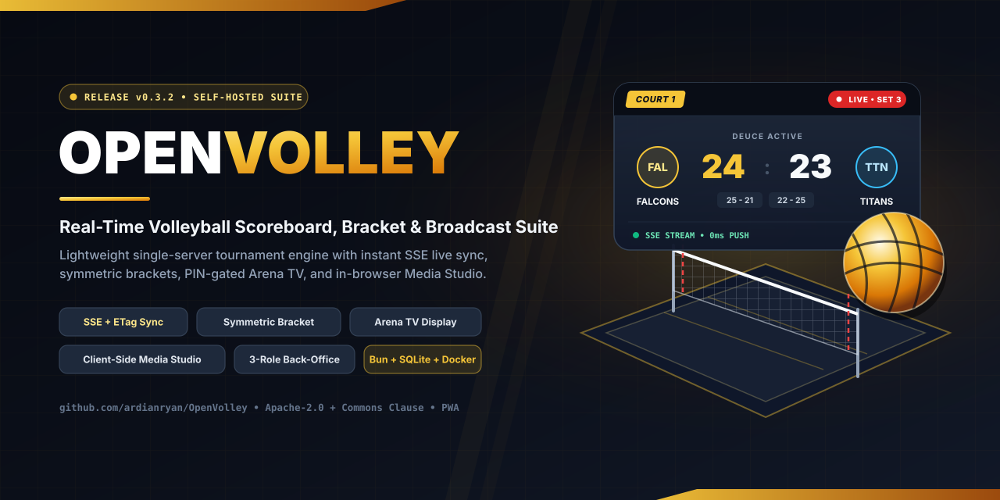
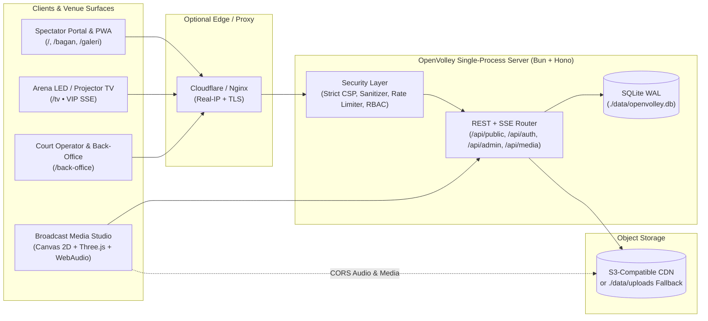

<div align="center">
  

  <br />

  [](https://github.com/ardianryan/OpenVolley/actions/workflows/ci.yml)
  [](https://github.com/ardianryan/OpenVolley/actions/workflows/codeql.yml)
  [](https://github.com/ardianryan/OpenVolley/actions/workflows/release-and-packages.yml)
  [](https://github.com/ardianryan/OpenVolley/releases)
  [](LICENSE)
  [](https://bun.sh)
  [](https://github.com/ardianryan/OpenVolley/pkgs/container/openvolley)
</div>

---

**OpenVolley** is a lightweight, self-hosted volleyball tournament platform combining **real-time rally scoring**, **automatic symmetric knockout brackets**, a **PIN-gated Arena TV / LED scoreboard**, and a **100% client-side Broadcast Media Studio** inside a single Bun + Hono + SQLite server.

> **Localization Note:** All source documentation, architecture guides, commits, and CI/CD pipelines are written in **English**. The shipped default user interface is localized in **Indonesian** (*Bahasa Indonesia*) for court officials, media crews, and tournament spectators.

---

## Key Capabilities

| Pillar | Highlights |
| :--- | :--- |
| **Real-Time Live Score Engine** | Official rally-point scoring (`Best of 3` / `Best of 5`, configurable `25`/`15` set points, optional `2-point Deuce`), explicit set-point confirmation guard to prevent accidental taps, serving indicator tracking, and multi-step action undo. |
| **Adaptive SSE + ETag Sync** | Instant Server-Sent Events (`/api/public/stream`) for up to `MAX_SSE_CLIENTS` concurrent spectators, seamlessly falling back to lightweight `ETag` (`304 Not Modified`) polling during traffic spikes. |
| **Master Registries & Hybrid FIVB TM Draw** | Unified **Master Contingents** (`/back-office/kontingen`) with Tab-separated Google Sheets import and automatic identity propagation across divisions without overwriting per-category staff overrides; searchable draw-slot comboboxes, seeded opposite-wing locking, anti-same-region Round-1 separation, and Pool Round-Robin (`3-2-1-0`) → Knockout advancement. |
| **Master Courts & Visual Schedule Board** | Centralized **Master Courts** & side-by-side cross-court schedule board (`/back-office/jadwal`) featuring 1-click **"Tarik Jadwal"** transfers and time-slot template copying between courts. |
| **Remote Multi-TV & Dynamic Standby Banners** | PIN-gated 16:9 venue screens (`/tv?screen=<slug>`) centrally remotely controlled from `/back-office/layar-tv` over priority VIP SSE (`1 Lapangan`, `Split 2`, `Auto 12d`, `Bagan / TM`, and customizable `Standby Banner` presets with WIB clock + running marquee). Public portal `/tv` button stays hidden unless explicitly enabled. |
| **Official Vector PDF Bulletins** | Lazy-loaded `jspdf` suite (`/back-office/dokumen`) producing per-day grouped Schedule & Results Bulletins, full-page vector Knockout Bracket trees, and 1-page A4 Official Match Summary sheets with timeouts/substitutions & signature blocks. |
| **Client-Side Broadcast Media Studio** | Browser-rendered `9:16`, `4:5`, `16:9`, and `1:1` posters (PNG) and animated broadcast videos (`MP4`/`WebM`) with 3D WebGL volleyball scenes, S3 audio tracks with smart auto-ducking, `1–3` photo collages/slideshows, in-browser video cut/trimmer (`2s–15s`), and automatic iPhone `.HEIC` / `.MOV` browser conversion. |
| **Multi-Slide & Video Moments Gallery** | Match gallery supporting swipeable multi-photo carousels, inline HTML5 video playback, uncropped fullscreen lightbox inspection, and direct S3-compatible object storage (with local disk fallback). |
| **3-Role Back-Office & Defense-in-Depth** | Granular RBAC (`admin`, `panitia`, `media`), `HttpOnly` JWT cookies, sliding-window brute-force rate limiting, strict `Content-Security-Policy` (no `'unsafe-inline'` scripts), magic-byte upload verification, and branded error pages (`400`–`503`, `Offline`, `ErrorBoundary`). |
| **Token-Gated OBS Overlays & Controller** | Dedicated transparent browser source (`/obs?token=<secret>`) with 5 broadcast variations (Scorebug, Lower-Third Bar, Pre-match VS Intro, Timeout/Set Break, Winner Card) controlled live from `/back-office/obs` with token regeneration & theme switching. |
| **FIVB Form O-2 Official Scoresheet** | Automated PDF generation of official FIVB Form O-2 scoresheets with roster management, starting lineups, set duration tracking, timeouts, substitutions, and referee sign-offs. |
| **Bilingual UI (ID / EN) & Integrations** | Persistent Indonesian & English dictionary switcher (`i18n.ts`); HMAC-SHA256 signed anti-SSRF outgoing Webhooks, and hot S3 SQLite database backup (`VACUUM INTO`). |
| **Court Schedule Management & Unschedule** | Interactive date/time editor with quick slot buttons, match unassigning/clearing, whole-court schedule bulk clearing, and unscheduled match drawer (`/back-office/jadwal`). |
| **Skippable 3rd Place Playoff ("Juara 3 Bersama")** | Dynamic option to skip 3rd place playoff match (`hasThirdPlace: false`), automatically recognizing both semifinal losers as Joint 3rd Place across brackets, podiums, Media Studio, and PDF bulletins. |
| **Cloud S3 Logo Storage & Runtime Auto-Migration** | Automatic migration of legacy local `/uploads/logos/...` to S3 bucket CDN without server bandwidth strain. |
| **Cloudflare Turnstile Bot Gate** | Zero-friction Turnstile challenge verification on public entry and back-office authentication forms. |

---

## System Architecture



---

## Quick Start

### Option A — Run Directly with Bun

**Prerequisites:** [Bun](https://bun.sh) `>= 1.2`

```bash
# 1. Clone the repository
git clone https://github.com/ardianryan/OpenVolley.git
cd OpenVolley

# 2. Install dependencies & configure environment
bun install
cp .env.example .env

# 3. Build the production frontend & start the server
bun run build
bun start
```

On startup, OpenVolley binds to `0.0.0.0:3000` and prints both `http://localhost:3000` and all detected LAN/Wi-Fi IPv4 URLs for instant mobile testing on the same network.

### Option B — Run with Docker Compose

```bash
cp .env.example .env
# Edit .env and set a strong JWT_SECRET (e.g. openssl rand -hex 32)

docker compose up -d --build
```

Or pull the prebuilt multi-arch (`linux/amd64`, `linux/arm64`) image from GitHub Container Registry:

```bash
docker run -d \
  --name openvolley \
  -p 3000:3000 \
  -e JWT_SECRET="$(openssl rand -hex 32)" \
  -e ADMIN_DEFAULT_PASSWORD="change-me-immediately" \
  -v openvolley_data:/app/data \
  ghcr.io/ardianryan/openvolley:0.3.0
```

### Default Seeded Accounts (First Boot Only)

> **Important:** Rotate all default credentials immediately via **Back-Office → Manajemen Akun** (`/back-office/akun`) before exposing the server publicly.

| Role | Default Username | Default Password | Capabilities |
| :--- | :--- | :--- | :--- |
| **Admin** | `admin` | `ADMIN_DEFAULT_PASSWORD` (`admin123` if unset) | Full access: tournaments, brackets, live scoring, Media Studio, event branding, sponsors, Arena TV PIN, and user management. |
| **Panitia** | `panitia` | `panitia123` | Court operations: tournament categories, team draws, match schedules, and live rally scoring. |
| **Media** | `media` | `media123` | Broadcast Media Studio: poster/video generation and Moments Gallery publishing. |

Default Arena TV PIN: `4426` (configurable in **Branding & Logo**).

---

## Environment Variables

| Variable | Default | Description |
| :--- | :--- | :--- |
| `PORT` | `3000` | HTTP port bound by the Bun server. |
| `HOST` | `0.0.0.0` | Network interface binding (`0.0.0.0` enables LAN mobile testing). |
| `JWT_SECRET` | *(dev fallback)* | **Required in production.** Secret key used to sign `HS256` session & TV VIP cookies. |
| `ADMIN_DEFAULT_PASSWORD` | `admin123` | Initial password seeded for `admin` when the database is empty. |
| `MAX_SSE_CLIENTS` | `150` | Maximum concurrent public SSE streams before excess clients seamlessly switch to ETag polling. |
| `MAINTENANCE_MODE` | `false` | When `true`, public API routes return `503 Service Unavailable` (`Retry-After: 60`) while keeping `/api/public/health` and Back-Office accessible. |
| `DB_PATH` | `./data/openvolley.db` | Custom SQLite database file path (`:memory:` is used automatically under `NODE_ENV=test`). |
| `S3_ENDPOINT` | *(unset)* | Optional S3-compatible endpoint (Cloudflare R2, AWS S3, MinIO, IDCloudHost IS3). Falls back to `./data/uploads` when omitted. |
| `S3_BUCKET` | *(unset)* | Target S3 bucket name. |
| `S3_PREFIX` | *(empty)* | Optional key prefix inside the bucket (e.g., `openvolley`). |
| `S3_PUBLIC_URL` | `${S3_ENDPOINT}/${S3_BUCKET}` | Public CDN base URL used to serve uploaded logos, slide photos, and gallery videos. |
| `S3_ACCESS_KEY_ID` | *(unset)* | S3 access key ID. |
| `S3_SECRET_ACCESS_KEY` | *(unset)* | S3 secret access key. |
| `S3_REGION` | `auto` | S3 signing region. |
| `S3_PATH_STYLE` | `true` | Set to `false` to use virtual-hosted-style bucket URLs. |

---

## Quality Assurance & Testing

OpenVolley ships with strict TypeScript checking alongside unit, feature, and end-to-end security tests:

```bash
# TypeScript static analysis
bun run typecheck

# Unit tests (bracket math, rally/deuce engine, sanitizers, HEIC/MOV magic bytes, theme cycle, timeline)
bun run test:unit

# Feature tests (3-role RBAC matrix, 8-team bracket lifecycle, deuce confirmation, ETag 304)
bun run test:feature

# End-to-End & Security tests (16-team draw, SVG/XSS upload rejection, strict CSP, rate limiting, multi-slide/video gallery)
bun run test:e2e

# Run the entire test suite
bun test
```

---

## Documentation Index

| Document | Purpose |
| :--- | :--- |
| [docs/INDEX.md](docs/INDEX.md) | Complete documentation overview and navigation map. |
| [docs/ARCHITECTURE.md](docs/ARCHITECTURE.md) | Deep dive into data model, adaptive SSE/ETag sync, and Media Studio rendering pipeline. |
| [docs/API.md](docs/API.md) | Complete HTTP REST & SSE endpoint specification. |
| [docs/DEPLOYMENT.md](docs/DEPLOYMENT.md) | Production deployment with Docker, Nginx + Cloudflare, S3 object storage, and SQLite backups. |
| [docs/TESTING.md](docs/TESTING.md) | Guide to unit, feature, E2E security, WCAG contrast, and ephemeral Docker smoke testing. |
| [docs/CITATION.md](docs/CITATION.md) | Academic and technical citation formats (BibTeX, APA, IEEE, CFF). |
| [.github/CUSTOM_PROPERTIES.md](.github/CUSTOM_PROPERTIES.md) | GitHub Repository Custom Properties schema and `gh api` provisioning commands. |
| [CHANGELOG.md](CHANGELOG.md) | Version history following Keep a Changelog & Semantic Versioning. |
| [TODO.md](TODO.md) | Completed `v0.1.0`–`v0.2.1` deliverables and upcoming `v0.3.0`–`v1.0.0` engineering roadmap. |
| [SECURITY.md](SECURITY.md) | Vulnerability disclosure policy and security architecture summary. |
| [CONTRIBUTING.md](CONTRIBUTING.md) | Contribution workflow, coding conventions, and pull request checklist. |
| [CODE_OF_CONDUCT.md](CODE_OF_CONDUCT.md) | Contributor Covenant v2.1 community standards. |

---

## Citation (BibTeX)

If you reference **OpenVolley** in academic papers, technical reports, tournament engineering case studies, or institutional documentation, please cite it using the following BibTeX entry (or GitHub's native **"Cite this repository"** button powered by [`CITATION.cff`](CITATION.cff)):

```bibtex
@software{ryan2026openvolley,
  author       = {Ryan, Ardian},
  title        = {{OpenVolley: A Self-Hosted Real-Time Volleyball Scoreboard, Symmetric Tournament Bracket, and Client-Side Broadcast Media Suite}},
  version      = {0.2.1},
  year         = {2026},
  month        = nov,
  url          = {https://github.com/ardianryan/OpenVolley},
  license      = {Apache-2.0 WITH Commons-Clause}
}
```

---

## License

Copyright © 2026 [Ardian Ryan](https://github.com/ardianryan).

**OpenVolley** is licensed under the **Apache License, Version 2.0** combined with the **Commons Clause License Condition v1.0** — see [`LICENSE`](LICENSE) and [`NOTICE`](NOTICE) for full legal terms:

- **Permitted (100% Free):** Self-hosting, inspecting, forking, modifying, and submitting pull requests; operating OpenVolley for school, collegiate, club, regional (*POPDA/PORPROV*), national (*PON*), or international volleyball competitions — **including commercial sporting events** that sell spectator tickets or display event sponsors.
- **Strictly Prohibited:** Selling, sublicensing for a fee, white-labeling for resale, or offering OpenVolley as a paid hosted/SaaS or paid managed service whose value derives substantially from OpenVolley.
